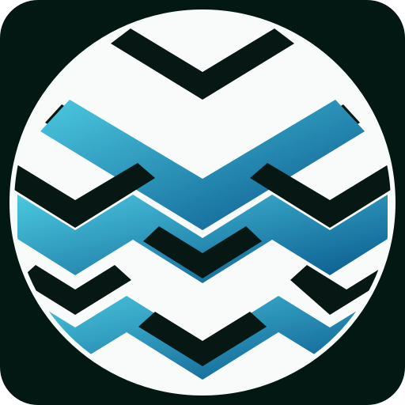

<div align="center">



# MUISYLE

### ELYSIUM CULTURE · MORE THAN A MEME. A WHOLE NEW VIBE.

A community-first creative universe shaped by internet culture, visual imagination, and the spirit of the Elysium ecosystem.

<br />

<a href="https://memeelysium.github.io/">
  
</a>
<a href="https://github.com/memeelysium/muisyle-elysium">
  
</a>

<br /><br />


</div>

---

## The MUISYLE universe

MUISYLE is an independent creative identity inspired by the energy of internet culture and the possibilities of the Elysium ecosystem.

We see memes as more than passing jokes. They are a shared language — a way for people to express ideas, create connections, and build a culture together.

> **More than a meme. A whole new vibe.**

Our universe brings that idea to life through a distinctive cosmic aesthetic and a growing set of community-focused experiences.

## Explore

| Experience | Description |
| --- | --- |
| **The Visual Universe** | A space-inspired visual world built around the MUISYLE identity. |
| **Community Meme Gallery** | Explore featured meme concepts and discover how to submit community creations. |
| **Community Profiles** | Create a public profile, introduce yourself, and find other members in orbit. |
| **Community Hub** | Follow the project and join the conversation through its official social channels. |
| **Responsive Interface** | A carefully styled experience for desktop and mobile screens. |

## Our direction

We want to build a recognizable home for creativity, humor, and community participation around the Elysium ecosystem.

- **Create freely** — make room for original ideas and unexpected perspectives.
- **Build together** — give community members ways to participate and be discovered.
- **Stay curious** — keep exploring new formats, creative tools, and experiences.
- **Keep it welcoming** — make the universe accessible to newcomers and long-time community members alike.

## Technology

MUISYLE is built as a lightweight web experience using browser-native technologies and selected open-source tools.

- HTML, CSS, and JavaScript
- Three.js for selected visual experiences
- Lucide icons
- Supabase-powered community functionality
- GitHub Pages for website hosting

The project is designed to run as a static website; no local build step is required for the basic experience.

## Elysium on-chain structure

MUISYLE is designed around the wider Elysium ecosystem. The following overview separates the website experience from the underlying blockchain infrastructure and provides a clear foundation for future on-chain integrations.

```text
                  MUISYLE COMMUNITY
                         │
                         ▼
                MUISYLE WEB EXPERIENCE
          Website · Meme Gallery · Profiles
                         │
             Wallet connection / dApp layer
                  (future integration)
                         │
                         ▼
                ELYSIUM EVM NETWORK
             Smart contracts · Transactions
                         │
              ┌──────────┴──────────┐
              ▼                     ▼
        On-chain assets       Blockchain explorer
        & interactions        Verification & data
```

### Network reference

The Elysium Foundation's developer documentation identifies the following network configuration:

| Network | Chain ID | RPC endpoint | Explorer |
| --- | ---: | --- | --- |
| Elysium Mainnet | `1339` | [rpc.elysiumchain.tech](https://rpc.elysiumchain.tech) | [explorer.elysiumchain.tech](https://explorer.elysiumchain.tech) |
| Atlantis Testnet | `1338` | [rpc.atlantischain.network](https://rpc.atlantischain.network) | [explorer.atlantischain.network](https://explorer.atlantischain.network) |

Useful ecosystem resources: [Elysium developer documentation](https://github.com/elysium-foundation/elysium-docs) · [Elysium Foundation](https://github.com/elysium-foundation/elysium).

### Elysium Mainnet token ecosystem

Elysium Mainnet already has an active token ecosystem. The public [Elyscan Token Tracker](https://elyscan.live/tokens) lists ERC-20 assets on the network and provides token pages for checking contract details, supply, holders, and activity.

The following is a **curated sample** of tokens currently surfaced by the tracker, not a complete list or a ranking. Token listings, holder counts, liquidity, and market data can change.

| Token | Symbol | Contract address |
| --- | --- | --- |
| [Montra](https://elyscan.live/token/0x063F7Cc5339f92a5FD7BaF3D22233044FdA1F327) | `MONTRA` | `0x063F7Cc5339f92a5FD7BaF3D22233044FdA1F327` |
| [Wrapped HYPE](https://elyscan.live/token/0xbA876237B0F021A6c6D852d6c26E107997cC5E81) | `WHYPE` | `0xbA876237B0F021A6c6D852d6c26E107997cC5E81` |
| [USDC](https://elyscan.live/token/0xb47c4C8F73F009CC0C0d3f92B388d13E293F0B65) | `USDC` | `0xb47c4C8F73F009CC0C0d3f92B388d13E293F0B65` |
| [Kinetiq Governance Token](https://elyscan.live/token/0xe45a355d9e9cAd2aD85F2d03E3eE3102A036acF0) | `KNTQ` | `0xe45a355d9e9cAd2aD85F2d03E3eE3102A036acF0` |
| [Elysium Pepe Acceleration](https://elyscan.live/token/0x716DA70796D502B3C9CEB5C4876BA60F511dD8A0) | `ep/acc` | `0x716DA70796D502B3C9CEB5C4876BA60F511dD8A0` |
| [MAXIMUS CAT](https://elyscan.live/token/0x979e08A83900336b1BCCb0818E55c7748aB438BE) | `MAXIMUS` | `0x979e08A83900336b1BCCb0818E55c7748aB438BE` |
| [BoxaV2](https://elyscan.live/token/0xb6825cC93Cc20CC37270C056969136dc439bDFC6) | `$BOXA` | `0xb6825cC93Cc20CC37270C056969136dc439bDFC6` |
| [Volta](https://elyscan.live/token/0x6721083BB7E56A8b5398f32a02D0AB55C87B63C8) | `VOLTA` | `0x6721083BB7E56A8b5398f32a02D0AB55C87B63C8` |
| [GOTEM](https://elyscan.live/token/0xA4d91152e453eAc3D6148bc25909b214D6225560) | `GOTEM` | `0xA4d91152e453eAc3D6148bc25909b214D6225560` |
| [e/acc](https://elyscan.live/token/0x62dC5b1DE5e1D3894639aEdC2ddd23d404BbfB70) | `e/acc` | `0x62dC5b1DE5e1D3894639aEdC2ddd23d404BbfB70` |

**How the token layer fits into the network**

```text
                 ELYSIUM MAINNET
                  Chain ID: 1339
                         │
                  EVM / ERC-20
                         │
              Deployed token contracts
                         │
          ┌──────────────┼──────────────┐
          ▼              ▼              ▼
      Ecosystem       Community       Stablecoin /
       tokens          tokens        wrapped assets
          │              │              │
          └──────────────┼──────────────┘
                         ▼
               Wallets · DEXs · dApps
                         │
                         ▼
                 Elyscan Explorer
          Contract · Holders · Transfers
```

**Important:** token names and symbols are not unique. Some assets may have multiple contracts or similarly named copies on the same network. Always verify the full contract address, network, liquidity, and contract details in the explorer before interacting. Inclusion here is informational only and is not an endorsement or investment recommendation. These are ecosystem assets, not MUISYLE-issued tokens.

### What this means for MUISYLE

- **Community layer:** the website is the public-facing home for MUISYLE content and participation.
- **Wallet layer:** wallet connectivity can provide a user-controlled way to interact with compatible dApps.
- **Smart-contract layer:** on-chain features should be implemented through verified contracts and clearly documented addresses.
- **Verification layer:** transactions and deployed contracts can be inspected through the network's block explorer.

**Implementation status:** this section documents the intended ecosystem architecture and network reference. It does not claim that MUISYLE has deployed its own smart contracts, issued an on-chain token, or enabled wallet transactions. Any future integration will be documented here only after it is implemented and verified. Always confirm network details against the Elysium documentation before connecting a wallet or signing a transaction.

## Run locally

Clone the repository:

```bash
git clone https://github.com/memeelysium/muisyle-elysium.git
cd muisyle-elysium
```

Then open `index.html` in a modern browser.

> Some community features rely on the configured Supabase project and may require an internet connection.

## Project structure

```text
.
├── assets/             # Visual and brand assets
├── brand-kit/          # Brand resources
├── supabase/           # Supabase-related project files
├── index.html          # Main website
├── styles.css          # Interface and responsive styling
├── script.js           # Main client-side interactions
├── three-scene.js      # Three.js visual experience
├── motion-effects.js   # Motion effects
├── chart-effects.js    # Chart-related effects
└── community-profile.js# Community profile functionality
```

## Community

The MUISYLE universe grows through the people who take part in it.

- **Website:** [memeelysium.github.io](https://memeelysium.github.io/)
- **X:** [@memeelysium](https://x.com/memeelysium)
- **GitHub:** [memeelysium](https://github.com/memeelysium)

Have an idea or something worth building? Open an issue or submit a pull request. Thoughtful contributions and creative suggestions are welcome.

## Independence & disclaimer

MUISYLE is an independent, fan-made community project. It is not an official Elysium product and is not affiliated with, endorsed by, or operated by the Elysium team.

Any references to Elysium are for ecosystem context only. Nothing in this repository or on the website constitutes financial, investment, or token-performance advice.

---

<div align="center">

**MADE FOR THE CULTURE. POWERED BY COMMUNITY.**

*Stay curious. Stay cosmic.*

</div>
